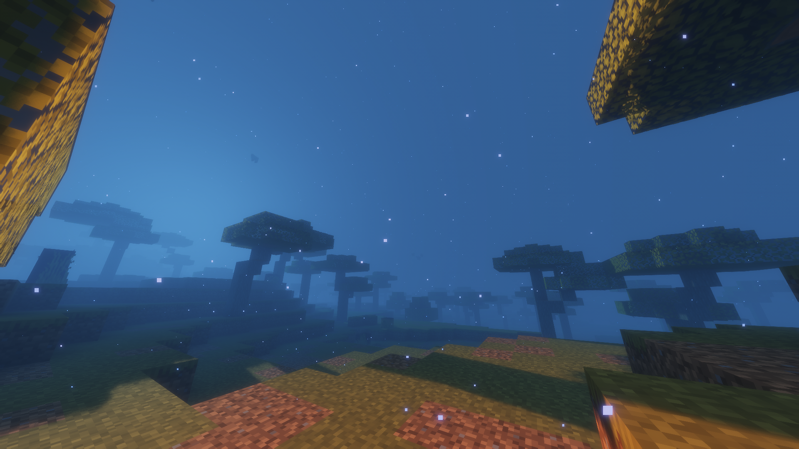
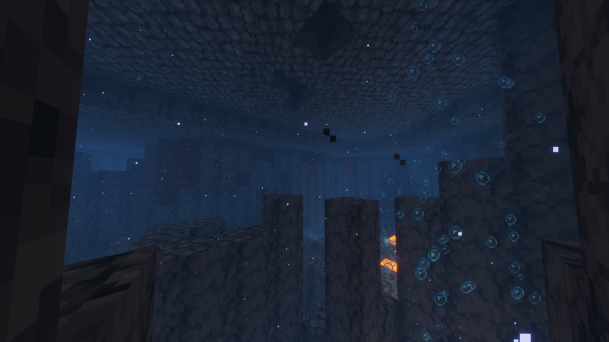
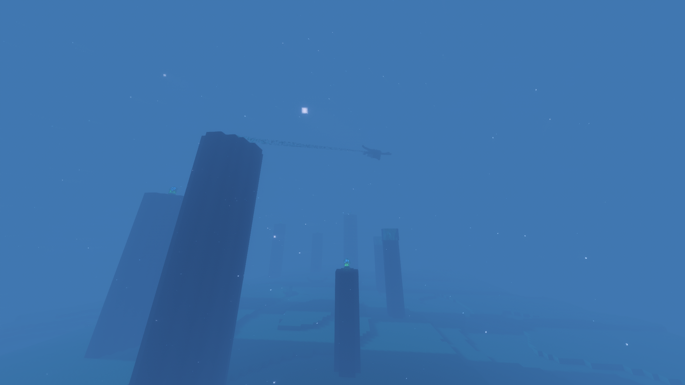

# Flood Mod

A Minecraft mod that transforms the entire world into an endless underwater realm. Every block of air across all dimensions - Overworld, Nether, and End - is replaced with water during world generation, creating a fully submerged experience.

## Requirements

- **Minecraft**: Java Edition 1.21.1
- **Fabric Loader**: Latest version for 1.21.1
- **Fabric API**: Required dependency
- **Java**: 21 or higher

## Important Notes

- **New Worlds Only**: This mod affects world generation. Existing worlds will only be modified in unexplored chunks. For the full experience, create a new world.
- **Spawn Point**: Players spawn underwater as usual.
- **Server Compatible**: Works on both singleplayer and multiplayer servers. Both server and clients should have the mod installed for the best experience.

## Usefull commands in-game
- /kill @e[type=item] removes all items that not in your inventory so they are not fucking your pc

## Screenshots





## Building from Source

If you want to build the mod yourself:

```bash
git clone https://github.com/cherrysies/flooded-world.git
cd flood-mod
./gradlew build
